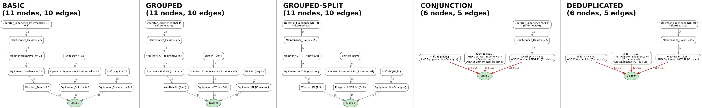
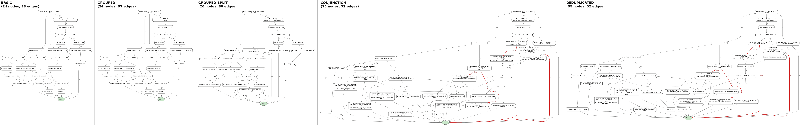
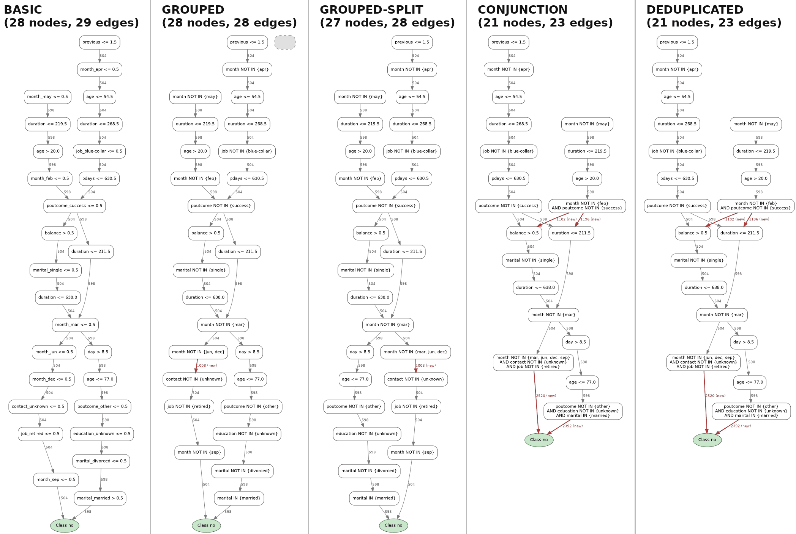
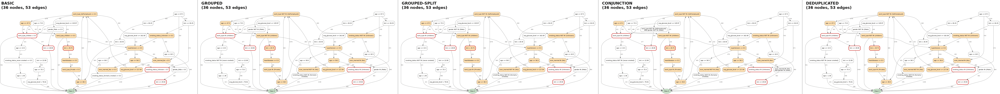
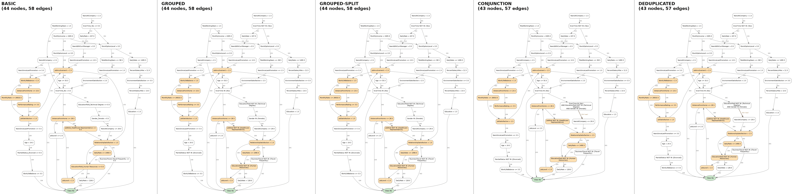
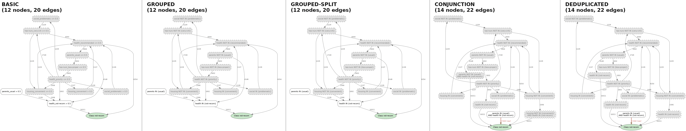
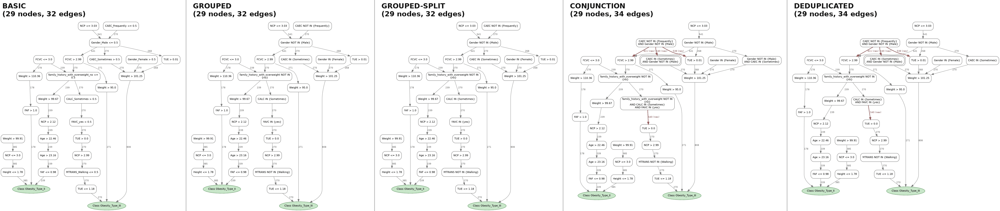
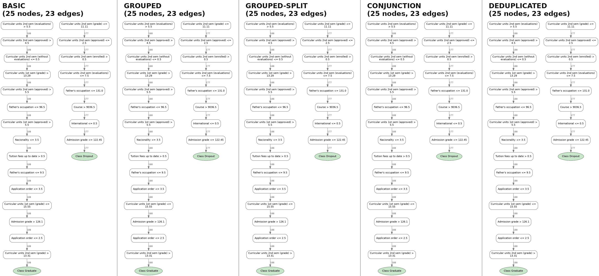

# DPG graph analysis: original vs transformed views

**Date:** 2026-10-15 (revision 2) · **Pipeline version:** `06e1266`
**Environment:** Python 3.12.9 with the `requirements.txt` pins (pandas 2.2.3, numpy 1.26.4,
scikit-learn 1.5.1, networkx 3.3, catboost 1.2.7). Revision 1 ran under pandas 3.0.3, numpy 2.4.6,
scikit-learn 1.9.0 and Python 3.13. The versions are now stored in each W&B run's config.
**Scope:** the 11 datasets of `run_all_categorical_experiments.py` (W&B project `dpg-categorical`,
group `run_all_categorical_basic`). `rain_australia` and `health_insurance` ran out of RAM on
this machine during DPG extraction (see [Dataset coverage](#dataset-coverage)); `dummy_dataset`
is sweep toy data.

## What changed in revision 2

* **Experiments rerun in the pinned environment** and uploaded to W&B (experiments + metrics tables).
  All 55 structure JSONs (11 datasets × 5 views) are **identical** to revision 1, and so are
  accuracy, F1, node/edge counts and the faithfulness columns. Only the two explanation metrics
  changed, as predicted in #2. The version change did not cause any of the graph problems below.
* **The "latent" problems (#3–#7) were checked against what DPG can actually produce.** A latent
  bug matters only if a real DPG can feed it the input it mishandles. Each one was traced back to
  the BASIC-graph shape it needs. Whether DPG can produce that shape was settled by a proof from
  how DPG builds edges, plus a stress test over 990 DPGs built with the repo's own code
  ([Can the latent cases come out of a real DPG?](#can-the-latent-cases-come-out-of-a-real-dpg)).
  Short answer: #5 cannot do harm on its own; #3 cannot happen in GROUPED/SPLIT; #3, #4 and #6
  can happen in CONJUNCTION/DEDUP, but only on paths that were already impossible in BASIC.
* **Three new problems:** DPG itself scrambles the order of long decision paths (#14, observed:
  it corrupts the dominant rule of `bank_marketing`); GROUPED-SPLIT does not terminate on
  same-feature cycles (#15); DPG's `n_jobs=1` path crashes (#16). In addition, on other seeds the
  CONJUNCTION pass hits its iteration cap in about 1 graph in 6, with graphs 12–75× larger (#8).
* **`--datasets health_insurance` now works** (the runners used to drop it silently). Both large
  datasets were tried and ran out of RAM here.

## How the graphs were checked

Every source → `Class` path of a graph encodes a rule: the conjunction of the node labels along it.
An independent checker (not reusing any parsing from `categorical/`) converted every path of every
view into the exact constraint it puts on the raw features (allowed value set per categorical
feature, interval per numeric feature), using the dataset CSV for the categorical domains. It then:

* checked the **original (BASIC) graph** for missing classes, cycles, unreachable nodes,
  contradictory paths (no row can satisfy them) and redundant tests;
* matched every path of each **transformed view** back to the BASIC path(s) it came from (following
  node ids, including the chains that were folded away) and compared the two constraints.

All paths were enumerated exactly, except for `titanic` whose 46-node cycle makes that impossible;
there 5,000 random paths per view were checked instead.

To confirm suspected bugs that the current data does not trigger, the transformation functions
themselves were called on small hand-built graphs (outputs reproduced below). To find out whether
real DPGs can trigger them, the same functions were run on 911 DPGs generated with the repo's
own code (see [the stress test](#stress-test)).

## Summary

**No transformed view changes the meaning of any path on any of the 11 pipeline graphs.** Every rule
in GROUPED, GROUPED-SPLIT, CONJUNCTION and DEDUPLICATED matches a rule of the BASIC graph, with the
same class. On other seeds and `perc_var` values, CONJUNCTION and DEDUP do change rules, but only
rules that were impossible in BASIC. In the stress test no transformation ever changed a rule that
real rows can follow.

"Reachable" = the code is wrong and DPGs built by the repo's code do trigger it, but not with the
pipeline's current settings. "Impossible" = no DPG can produce the input (proved from how DPG
builds edges, and confirmed by the stress test).

| # | Problem | Where | Status | Impact | Solution ([plans](plans/README.md)) |
|---|---|---|---|---|---|
| 1 | Edge weights are summed when chains are folded | split, conjunction, dedup | **observed** (5/11 datasets) | weights inflated up to 4.5×; edge thickness and weight-based metrics no longer comparable to BASIC | [1a](plans/1a.md): a folded edge keeps the weight of the edge it replaces. [1b](plans/1b.md): a clone takes its share of the original's outgoing weight. Together: every view back to 1.00× |
| 2 | `explanation_agreement` / `explanation_overlap` are wrong under pandas 3 | `dpg_equivalence.py` | **fixed by the pinned env** (rerun on W&B) | revision 1 reported 0.43–0.59; the rerun gives 1.00 | [2a](plans/2a.md): pick categorical columns the way `pd.get_dummies` does (`categorical/onehot.py`), not by dtype |
| 3 | Two `IN` tests on the same feature are merged by **union** | grouping, split, conjunction | impossible in GROUPED/SPLIT; **reachable** in CONJUNCTION | an impossible rule becomes a valid one; never touches a satisfiable rule | [3a](plans/3a.md): intersect `IN` sets; on an empty intersection keep both clauses (contradiction visible); never merge `IN`→`IN` in GROUPED/SPLIT; same fix in the metric. Optional [3b](plans/3b.md): flag unsatisfiable nodes |
| 4 | Opposite-operator clauses keep the "smaller set" | conjunction `_simplify_same_base` | **reachable** | same as #3: only on contradictions | [4a](plans/4a.md): `IN (in \ not_in)`; if empty, keep the clauses as they were |
| 5 | Dedup restriction for parent `IN` / child `NOT IN` is wrong | dedup `_restrict_clause` | **reachable**, rare | only on contradictions (hides one); on every satisfiable path the output means the same | [5a](plans/5a.md): keep `c ∩ p` (two-line fix) |
| 6 | Dedup rewrites a node from one parent's condition while it has others | dedup `_deduplicate_labels` | **reachable** | on real DPGs only downstream of #3/#4; harmless once those are fixed | [6a](plans/6a.md): rewrite or drop a node only when it has one parent. Optional [6b](plans/6b.md): multi-parent rewrite when all parents agree |
| 7 | One-hot column guessed with `rsplit("_", 1)` | all grouping scripts + `dpg_equivalence.py` | **reachable** (seen on accidents_mining; affected columns in 5 local datasets) | wrong feature/value in labels; numeric tests shown and merged as categories | [7a](plans/7a.md): store the real one-hot map in the structure JSON and use it in every rewrite and in the metric. Alternative [7b](plans/7b.md): unambiguous `prefix_sep` (changes every label) |
| 8 | Cloning makes the "grouped" graph bigger | split, conjunction | **observed** | adult_subset: 24 → 35 nodes; on other seeds CONJUNCTION hits its iteration cap in 142–146 of 911 graphs, 12–75× larger | [8a](plans/8a.md): never merge into a node whose *original* id is on a cycle. Cause found: clones of cycle nodes escaped the SCC exclusion (1,207 of 1,352 clones on accidents_mining). With the guard: 34 → 37 nodes instead of 1,386. Optional [8b](plans/8b.md): clone budget / no-clone mode |
| 9 | BASIC graphs explain only some classes | original DPG | **observed** (7/11) | e.g. nursery shows 1 of 5 classes | [9a](plans/9a.md): report class coverage as a metric. Optional [9b](plans/9b.md): per-class `perc_var` filter |
| 10 | BASIC graphs contain cycles and contradictory paths | original DPG | **observed** (5/11) | titanic: 61% of paths impossible | [10a](plans/10a.md): measure cycle size and contradictory/redundant path shares per view (no structural fix; inherent to DPG) |
| 11 | Nursery: 9 of 12 nodes unreachable | original DPG | **observed** | only one usable rule | [11a](plans/11a.md): record where traces start and add a virtual `Start` node to the structure JSON (the degree checks then protect start nodes). Alternative [11b](plans/11b.md): `start_nodes` attribute plus a guard per transformation |
| 12 | `credit_card_visual` duplicates `credit_card_approval` | datasets | **observed** | same graphs, double-counted in aggregates | [12a](plans/12a.md): exclude from the default runs. Alternative [12b](plans/12b.md): delete (needs the author's OK) |
| 13 | Absorbed nodes left in `graph["nodes"]` | `cat_grouping._build_grouped_structure` | **observed** (bank_marketing) | orphan unlabelled node; GROUPED node count off by one per merge | [13a](plans/13a.md): also filter absorbed ids out of `graph["nodes"]` |
| 14 | `discover_dfg` scrambles paths of 16 or more tests | `dpg/core.py` | **observed** (bank_marketing) | the dominant bank_marketing rule is stored with its tests in the wrong order | [14a](plans/14a.md): remove the sort (`groupby` already keeps trace order), then regenerate |
| 15 | GROUPED-SPLIT never finishes on same-feature cycles | `cat_grouping_split.py` | **reachable** (`perc_var` 0.001) | the pass runs to its iteration cap | [15a](plans/15a.md): 8a's cycle guard in the split script (validated: no cap, BASIC size) |
| 16 | `fit` crashes with `n_jobs: 1` | `dpg/core.py` | **observed** (not used by the pipeline) | `ValueError` from `pd.DataFrame` | [16a](plans/16a.md): sequential paths return one list per sample, like the parallel path (also fixes the crash in the parallel fallback) |

Each problem has one or more implementation plans in [`plans/`](plans/README.md)
(`<number><letter>.md`; `a` is the recommended approach). The plans are instructions for coding
agents: exact files and functions, tests, and acceptance criteria. [`plans/README.md`](plans/README.md)
gives the execution order and the shared validation tools.

Why #3–#6 only hit impossible rules: on a single tree path the tests are always consistent and
never redundant (F2 below), so any contradiction on a BASIC path joins edges from different trees.
That is exactly the input #3–#5 mishandle, and it also occurs outside cycles, where the conjunction
pass does merge.

---

## Can the latent cases come out of a real DPG?

A transformation bug only matters if DPG can produce the input it mishandles. This section works out,
for each latent problem, which BASIC-graph shape triggers it and whether DPG can build that shape.

### What a DPG edge can and cannot be

**F1.** DPG traces every training row through every tree. An edge `a -> b` exists only if some row
passed test `a` and then, *as the next node of the same tree*, test `b`, on a path variant
frequent enough to survive `perc_var`. (This assumes the trace order is kept, which #14 breaks
for paths of 16+ tests.)

**F2.** scikit-learn never splits a node on a feature that is constant in that node, and never
picks a threshold that leaves one side empty. Within one tree path, therefore:

* (a) after `X_a > 0.5` (X = a), no test on any one-hot column of X follows, because they are all
  constant;
* (b) after `X_a <= 0.5`, no further test on `X_a` follows (other values of X still can);
* (c) more generally, no test is implied by, or contradicts, the tests above it. A
  `duration <= 638.0` can never follow `duration <= 268.5`.

**F3.** So the tests along one tree path are always jointly satisfiable and never redundant.
**A BASIC path that is contradictory or contains a redundant test must change trees between two
of its edges.** Nothing confines such joins to cycles. The conjunction script refuses to merge
inside cycles, but contradictory joins also occur in the acyclic part (examples below).

Both facts were checked on every graph of the stress test. Builds with the true trace order
contain **no** edge violating F2(a)/(b). The only violations come from the scrambled traces of #14.

### Stress test

`categorical/graph_analysis/latent_reachability.py` builds DPGs with the repo's own
`DecisionPredicateGraph`: the pipeline's RandomForest recipe and `load_dataset`, the trace log from
`fit`, the repo's `filter_log` and `discover_dfg`, and the structure exactly as
`generate_dot`/`to_networkx` write it. On the pipeline's own settings it reproduces the
pipeline's BASIC graphs exactly: the same nodes, edges, weights and node order, and the same
CONJUNCTION labels, on all 5 datasets compared (accidents_mining, bank_marketing,
credit_card_approval, nursery, titanic). Every graph then goes through GROUPED, SPLIT, CONJUNCTION
and DEDUP with the suspect functions wrapped. Each call is checked semantically against the
dataset's category domains: does the output still mean the same as the input? When it doesn't,
was the input already unsatisfiable (a contradiction gets hidden) or satisfiable (a rule that real
rows follow changes)? DEDUP is also checked edge by edge against every parent of each rewritten node.

Grid: 10 datasets (credit_card_visual skipped as a duplicate) × 11 seeds (0–9 and the pipeline's
27) × 5 / 10 / 20 trees × `perc_var` 0.01 / 0.005 / 0.001 = 990 configurations. 911 of them keep at least
one path (the other 79 keep none at that `perc_var`). Each is built twice: with DPG's own
`discover_dfg` ("repo DPG") and with every trace in its true order.

Results for the repo-DPG build. GROUPED/SPLIT rows come from a run with a 5 s limit per view;
CONJUNCTION/DEDUP rows from a re-run of the whole grid with a 600 s limit. "Reached" counts how often
the branch ran, "wrong" how often its output meant something different from its input:

| # | branch | reached (graphs) | wrong, input already impossible (graphs) | wrong, satisfiable input (graphs) |
|---|---|---|---|---|
| 3 | GROUPED / SPLIT: `IN` ∪ `IN` | 0 | 0 | 0 |
| 3 | CONJUNCTION: `IN` ∪ `IN` inside one node | 96,085 (126) | 32,479 (66) | 0 |
| 3 | CONJUNCTION: `IN` ∪ `IN` across a merge boundary | 7,052 (95) | 0 | 0 |
| 4 | CONJUNCTION: opposite operators | 285,720 (347) | 113,440 (119) | 0 |
| 5 | DEDUP: parent `IN` / child `NOT IN` | 6 (3) | 1 (1) | 0 |
| 6 | DEDUP: rewrite of a child with one parent | 10,444 (551) | 1 (1) | 0 |
| 6 | DEDUP: rewrite of a child with several parents | 15,490 (103) | 585 (39) | **264 (17)** |
| 6 | same, with #3/#4 fixed (the 18 configurations involved, 54 graphs) | 6,474 (25) | 0 | **0** |
| – | DEDUP: the other restriction cases (`IN`/`IN`, `NOT IN`/`IN`, `NOT IN`/`NOT IN`) | 11,925 | 0 | 0 |
| – | DEDUP: CONJUNCTION edges checked for a lost connection | 1,125,171 edges (901) | – | 0 lost |
| 7 | CONJUNCTION label: numeric column shown as a category | 177 (110) | – | – |
| 7 | CONJUNCTION label: one-hot column split at the wrong `_` | 331 (147) | – | – |

The true-order build gives the same zeros, the same 17 graphs for #6 (262 changed labels) and
counts within 20% of the ones above. Other findings of the grid:

* **F2 violations:** 178 edges in 79 graphs of the repo-DPG build, all from #14's scrambled traces;
  none in the true-order build.
* **SPLIT did not finish in 5 s** on 220 graphs (209 true-order), the #15 cycles. Its #3 count above
  covers what ran before the limit; the proof does not depend on it.
* **CONJUNCTION hit its iteration cap** on 146 graphs (142 true-order) and grew 12–75× (see #8).
* **CONJUNCTION/DEDUP did not finish in 600 s** on 10 graphs (11 true-order), all at `perc_var`
  0.001. Their counts stop at the limit.

---

## Problems in the transformed views

### 1. Edge weights are summed when chains are folded (observed)

When a node absorbs its successor, the weight of the absorbed edge is **added** to every outgoing
edge (`edges[(u, d)] += w + w_uv` in `_fold_forward` of `cat_grouping_split*.py`, same rule in
`cat_grouping._apply_grouping` and in the dedup rewire). A chain `A -43-> B -43-> C -43-> Class`
becomes `A∧B∧C -129-> Class`, although the same 43 samples flow through it.

Total weight flowing into the class nodes, relative to BASIC:

| dataset | GROUPED | SPLIT | CONJUNCTION | DEDUPLICATED |
|---|---|---|---|---|
| accidents_mining | 1.00× | 1.00× | **2.68×** | **2.68×** |
| adult_subset | 1.00× | **1.51×** | **3.81×** | **3.81×** |
| bank_marketing | 1.00× | 1.00× | **4.46×** | **4.46×** |
| credit_card_approval / _visual | 1.00× | 1.00× | **1.92×** | **1.92×** |
| nursery | 1.00× | 1.00× | **3.22×** | **3.22×** |
| other 6 datasets | 1.00× | 1.00× | 1.00× | 1.00× |

Inflated edges are drawn **red** in the figures (label: new weight, BASIC weight in brackets).
Because longer chains accumulate more, the inflation is uneven within one graph: in
accidents_mining the three edges into `Class 0` go from 42 / 43 / 46 to 84 / 129 / 138, so their
relative order now reflects chain length, not traffic. Anything weight-based (edge thickness in the
renders, communities, edge metrics) is distorted. Keeping the weight of the outgoing edge (or the
minimum along the chain) would preserve the meaning.

### 2. Explanation-agreement metric broken by pandas 3 (fixed by the pinned environment)

`dpg_equivalence.load_categorical_domains` selects categorical columns with
`df[col].dtype == object`. Revision 1 ran under **pandas 3.0.3** (`requirements.txt` pins 2.2.3),
where text columns have dtype `str`, so the function returned **no domains** (logged as
`domain-aware canonicalisation on for 0 categorical column(s)`). Without domains, mixed
`IN`/`NOT IN` clauses are not normalised, and equivalent routes are counted as different.

Under pandas 2.2.3 the domains are found (1–10 categorical columns per dataset), and the rerun
uploaded to W&B gives:

| dataset | view | revision 1 (pandas 3) | revision 2 (pandas 2.2.3) |
|---|---|---|---|
| accidents_mining | CONJUNCTION, DEDUPLICATED | 0.593 (overlap 0.599) | **1.000** (overlap 1.000) |
| bank_marketing | CONJUNCTION, DEDUPLICATED | 0.433 (overlap 0.570) | **1.000** (overlap 1.000) |
| titanic | GROUPED-SPLIT | overlap 0.826 | overlap 0.830 |

Every other cell of the metrics tables is unchanged. This agrees with the checker: these views are
exact rewrites. The code still breaks as soon as someone installs pandas 3; the robust fix is
`pd.api.types.is_string_dtype(df[col]) or df[col].dtype == object`.

Note also that step 2 of `canonical_constraints` unions same-operator `IN` sets, i.e. the metric
shares bug #3 and could not detect it.

### 3. Two `IN` tests on the same feature are merged by union (CONJUNCTION only; contradictions only)

`X IN {a}` then `X IN {b}` means `X = a AND X = b` (impossible), but the chain merge writes
`X IN {a, b}` (either). Unioning categories is only correct for `NOT IN`. The code is in
`cat_grouping._apply_grouping`, `cat_grouping_split._split_then_merge` (both branches),
`cat_grouping_split_conjunction._combine_clauses` and `_simplify_same_base` case 1.

```
BASIC:        X_a > 0.5 -> X_b > 0.5 -> Class 1      (no row can follow this)
GROUPED:      X IN {a, b} -> Class 1                  (every row with X=a or X=b)
SPLIT:        X IN {a, b} -> Class 1
CONJUNCTION:  X IN {a, b} -> Class 1
```

For `IN` the merged set must be the **intersection**.

**Can DPG produce it?**

* **GROUPED and SPLIT: no.** Both merge only along an edge `X IN {..} -> X IN {..}`. In BASIC that is
  an edge `X_a > 0.5 -> X_b > 0.5`, which F2(a) rules out. The SPLIT relabelling and folding never
  create such an edge either (an `IN` node never absorbs anything, since that would need the same
  edge). Even #14's scrambling can't create one: it only reorders tests from one real path, and
  no real row satisfies `X = a` and `X = b`. Stress test: 0 occurrences in GROUPED and SPLIT
  over all 911 graphs, in both builds (SPLIT counted up to its 5 s limit on the 220 graphs where
  #15 kept it running).
* **CONJUNCTION: yes, often.** Merged nodes collect whole chains across features, so a chain
  `X_a > 0.5 -> Y.. -> X_b > 0.5` built from two trees reaches the union. Stress test:
  the union ran 96,085 times in 126 of the 911 graphs and changed the meaning 32,479 times in
  66 of them (true order: 101,104 / 123 and 32,905 / 66). The input was a contradiction every time. A **satisfiable path can never be
  changed** by this bug: a satisfiable chain never holds two different `IN` values of one feature.
  The harm is that an impossible rule turns into a valid-looking one, e.g. (accidents_mining,
  seed 27, 10 trees, `perc_var` 0.005): `sex IN {Male} AND sex IN {Female}` → `sex IN {Male, Female}`.

### 4. Opposite-operator clauses: "keep the smaller set" (contradictions only)

`_simplify_same_base` (conjunction), case 2: when a node has both `X IN {...}` and
`X NOT IN {...}`, it keeps whichever set is smaller and drops the other. The correct result is
`X IN (in_set \ not_in_set)`.

```
BASIC:        X_a > 0.5 -> X_a <= 0.5 -> Class 1     (impossible)
CONJUNCTION:  X IN {a} -> Class 1                     (tie -> keeps IN, contradiction gone)

BASIC:        X_b <= 0.5 -> Y_p > 0.5 -> X_a > 0.5 -> X_c > 0.5 -> Class 1
CONJUNCTION:  X NOT IN {b} AND Y IN {p} -> Class 1    (the X IN {a, c} test is dropped entirely)
```

**Can DPG produce it?** The branch runs constantly (a tree often tests `X_b <= 0.5` and later
`X_a > 0.5`). It returns a wrong result only on contradictory input. With a satisfiable chain the
`IN` set is a single value `a` (two values need #3's contradiction) and `a` is not in the
`NOT IN` set. Keeping `IN {a}` (tie or smaller) is then exactly `IN ({a} \ not_in)`. The second
example above needs `X_a > 0.5 -> X_c > 0.5`, a contradiction as well. Stress test: the branch
ran 285,720 times in 347 graphs and changed the meaning 113,440 times in 119 of them (true order:
292,252 / 348 and 115,981 / 117), always from contradictory input, e.g. `Shift IN {Night} AND Shift NOT IN {Night}` → `Shift IN {Night}`.

### 5. Dedup restriction for parent `IN` / child `NOT IN` (harmless on any satisfiable path)

`cat_duplicate_split_peer._restrict_clause`, case parent `X IN {p}`, child `X NOT IN {c}`: the code
(and docstring) keep `c \ p`; the values that still matter under the parent are `c ∩ p`.

```
_restrict_clause(("X","IN",["a"]), ("X","NOT IN",["a","c"]))  ->  ('X', 'NOT IN', ['c'])
correct: ('X', 'NOT IN', ['a'])   (parent X=a, child excludes a: impossible, should stay visible)
```

**Can DPG produce it?** The function is wrong as written, but it can only change a meaning when
the path is already impossible:

* Every row that passes the parent has `X ∈ p`, so the code's output `X NOT IN (c \ p)` is
  always true there, whatever `c` is. The correct output `X NOT IN (c ∩ p)` differs from it only
  when `c ∩ p ≠ ∅`.
* A one-clause parent `X IN {p}` comes from one one-hot test `X_a > 0.5`, so `p = {a}`. A larger
  `p` only comes from #3, which needs a contradiction. `c ∩ p ≠ ∅` then means `a ∈ c`: the path
  tests `X = a` and later `X ≠ a`. **No row can follow it.**
* On every satisfiable path (`a ∉ c`), both outputs are always true for rows that pass the
  parent. The code leaves a redundant clause in place, a missed simplification with the same
  meaning. **On any path that real data can follow, #5 changes nothing.**
* The branch is reached at all only through a cross-tree join. By F2(a) the BASIC successor of
  `X_a > 0.5` never tests X, so the `X NOT IN` clause must come from further down a folded chain
  that switched trees.

Stress test: the branch ran 6 times in 3 of the 911 graphs (both builds) and changed a meaning
once. That one case (accidents_mining, seed 5, 5 trees, `perc_var` 0.005, true
trace order): parent `Weather IN {Fog}`, child `Weather NOT IN {Fog} AND Equipment NOT IN {Conveyor}`.
The child is rewritten to `Equipment NOT IN {Conveyor}`, which hides the contradiction the correct
rule would keep. With #3/#4 fixed, the branch was never reached in the targeted re-run below.
**Verdict: fixing #5 is cosmetic for valid rules. It matters only for keeping impossible rules
visible, and #3/#4 do much more of that damage.**

### 6. Dedup ignores the child's other parents (only downstream of #3/#4)

The dedup pass tightens `v`'s label using the condition of one parent `u`, but never checks whether
`v` has other incoming edges. The rewritten label is then wrong for every path through the other
parents. The docstring's equivalence guarantee assumes `v` has a single parent.

```
before:  u1 = X NOT IN {a} -> v,   u2 = W > 3.0 -> v,   v = X NOT IN {a, b} AND Y IN {p}
after:   v  = X NOT IN {b} AND Y IN {p}      (path via u2 no longer excludes X = a)
```

**Can DPG produce it?** The shape does occur. Cloning in the conjunction pass gives conjunction
nodes up to 64 parents, and the multi-parent rewrite ran 15,490 times in 103 graphs (12,787 in
100 with the true trace order). It changed a meaning 849 times: 585 times where the parent's label
was already contradictory (39 graphs), and 264 times where it looked satisfiable (17 graphs:
accidents_mining 8, nursery 6, bank_marketing 2, adult_subset 1). In the examples inspected, those
"satisfiable" parent labels had already been corrupted by #3/#4 (e.g. `Equipment IN {Truck, Drill}`,
the union of an impossible `Truck ∧ Drill`). To separate the two effects, every configuration
behind those 17 graphs was re-run with correct #3/#4 (intersection for `IN`; `in \ not_in` for
opposite operators; contradictions kept visible) and a 900 s limit: 18 configurations, all three
`perc_var` values, 54 graphs. All 17 affected graphs finished. The multi-parent rewrite ran 6,474
times in 25 graphs (5,711 times in the 17 affected ones) and **never changed a meaning**, neither
from satisfiable nor from contradictory input. This is expected. The conjunction pass gives a
node a second parent only by cloning, and a clone carries the clauses the rewrite relies on. **So
on real DPGs, #6 does harm only on paths #3/#4 have already broken.** The hand-made shape above
still breaks the standalone CLI on arbitrary JSON, so the `in_degree(v) == 1` guard is still worth
adding.

Dedup also drops the incoming edges of other parents when it deletes an emptied node (the
`weights.pop` on the next sweep). The stress test checked every CONJUNCTION edge against DEDUP and
found no lost connection in 1,125,171 edges (901 graphs).

### 7. One-hot columns guessed with `rsplit("_", 1)` (reachable on 5 local datasets)

`_split_one_hot_column` assumes the category value has no `_`, and treats *any* `name_word` column
tested at threshold 0.5 as a one-hot dummy:

```
_split_one_hot_column('job_self_employed') -> ('job_self', 'employed')   true: ('job', 'self_employed')
_split_one_hot_column('has_loan')          -> ('has', 'loan')            true: numeric 0/1 column 'has_loan'
```

The second case is not limited to 0/1 columns. A tree splits a numeric column at 0.5 whenever the
column holds both 0 and 1, so integer counts are affected too: `Maintenance_Hours > 0.5` (values
0–9) is rendered as `Maintenance IN {Hours}`, and the conjunction pass then merges it as if it were
a category. The recent commits work around the first case by editing dataset values
(`Govt_job` → `Govt-job`, `Travel_Rarely` → `Travel-Rarely`, renaming `heart_disease`). A check of
every column of every local dataset still finds:

| dataset | column | rendered as | effect |
|---|---|---|---|
| accidents_mining | numeric `Maintenance_Hours` (0–9) | `Maintenance IN {Hours}` / `NOT IN {Hours}` | a numeric test shown and merged as a category |
| credit_card_approval (+ _visual) | numeric `person_emp_exp` (0–125) | `person_emp IN {exp}` | same |
| health_insurance | numeric `Region_Code`, `Driving_License`, `Previously_Insured` | `Region IN {Code}`, ... | same |
| obesity_levels_uci | one-hot `MTRANS_Public_Transportation` | feature `MTRANS_Public`, value `Transportation` | wrong feature; never grouped with other `MTRANS` tests |
| nursery | one-hot `children_1`, `children_2`, `children_3` | left as `children_1 <= 0.5` (numeric last token) | never grouped (value `more` is) |

The current pipeline graphs happen to avoid all of these (accidents tests `Maintenance_Hours > 2.5`,
obesity only `MTRANS_Walking`). With other seeds and tree counts they do appear. Across the
stress-test grid, an affected column is tested in a BASIC label in 61 of 91 non-empty
accidents_mining graphs (`Maintenance_Hours`), 49 of 99 credit_card_approval graphs
(`person_emp_exp`), 68 of 99 nursery graphs (`children_1/2/3`) and 79 of 93 obesity_levels_uci
graphs (`MTRANS_Public_Transportation`). In CONJUNCTION, a numeric column was written as a category
177 times (110 graphs), and a one-hot column split at the wrong `_` 331 times (147 graphs). The meaning is
preserved (the label still maps back to the same column), but the labels are wrong and a numeric
test ends up inside categorical conjunctions. The real column list is available at encoding time
(`pd.get_dummies` input), so the split could use it instead of guessing.

### 8. Cloning makes the "grouped" graphs bigger (observed)

The split strategy clones shared nodes so merges don't affect other branches. On adult_subset this
creates 15 clones in the CONJUNCTION view: **24 → 35 nodes, 33 → 52 edges, 583 → 2080 predicate
characters**, with labels up to 124 characters. On nursery the conjunction view grows from 12 to 14
nodes, all of the growth inside the unreachable region (#11). This runs against the purpose of
grouping (a more readable graph) and is worth weighing per dataset.

On other seeds the conjunction pass can also run away. In the stress test, its size relative to
BASIC splits into two groups with nothing in between. 758 true-order graphs end at most 3.1×
larger (median 1.0×). The other 142 (146 in the repo-DPG build) hit the pass's iteration cap,
`10 × (edges + labels + 10)`, and end **12–75× larger** (median 31×): e.g. bank_marketing seed 3,
5 trees, `perc_var` 0.005, 145 → 4,073 nodes. A capped result is whatever state the loop had reached,
not a finished merge. The cap hits 8 of the 10 datasets, all except
students_dropout_success and titanic. Most hits are at `perc_var` 0.005 (93) and 0.01 (46). The
pipeline's own settings stay clear of it, but the pipeline seed and tree count (27, 10 trees) at
`perc_var` 0.005 already hit it on accidents_mining (34 → 1,386 nodes) and adult_subset
(52 → 1,628). The conjunction script excludes edges inside cycles, but only by the original node
ids. A merge that enters a cycle from outside makes the absorbing node inherit edges into the
cycle, and clones of cycle nodes get new ids that the exclusion does not know. So the pass walks
around the cycle like #15 does. On the accidents_mining case, 1,207 of the 1,352 clones are copies
of the 24 cycle nodes. Refusing merges into any node whose original id lies on a cycle stops it
(34 → 37 nodes; see [plan 8a](plans/8a.md)).

### 13. GROUPED keeps absorbed nodes in `graph["nodes"]` (observed)

`cat_grouping._build_grouped_structure` drops absorbed nodes from the top-level `nodes` list and from
the edges, but copies `graph["nodes"]` unchanged. Every absorbed node therefore survives as an
isolated node without a label (the empty grey box in the bank_marketing GROUPED figure). Metrics that
count `graph["nodes"]` are off by one per merge: the metrics table reports 28 nodes for
bank_marketing GROUPED, the real graph has 27. The split/conjunction scripts rebuild the graph from
scratch and are not affected.

### 15. GROUPED-SPLIT does not terminate on same-feature cycles (reachable, new)

`cat_grouping_split._split_then_merge` has no cycle guard. (The conjunction script excludes edges
inside strongly connected components for exactly this reason; the split script does not.) When
DPG produces a cycle of same-feature `NOT IN` nodes, the split pass clones around the loop
indefinitely. Each iteration rescans every edge while the clone count grows, so the run only stops
at its iteration cap, `10 × (edges + nodes + 10)` iterations later. On `bank_marketing` with
`perc_var = 0.001` (seed 27, 10 trees), the true-order BASIC graph has two such cycles:

```
month NOT IN {apr} -> month NOT IN {aug} -> ... -> month NOT IN {apr}     (10 months)
job NOT IN {entrepreneur} -> ... -> job NOT IN {entrepreneur}             (6 jobs)
```

None of the 11 pipeline graphs has such a cycle. In the stress test, SPLIT did not finish within
5 s on **209 of the 911 true-order graphs**: 2 of 264 at `perc_var` 0.01, 26 of 317 at 0.005 and 181 of
330 at 0.001 (0.001 is the value the pipeline uses for `rain_australia` and `health_insurance`). All
28 cases at 0.01 / 0.005 were re-run without a time limit (`outputs/latent_reachability/split_cycle_check.txt`).
Every one has a same-feature cycle, and every one ends at the iteration cap after 7–104 s with a
graph **29–52 times larger** than BASIC (e.g. bank_marketing seed 3: 145 → 4,223 nodes).
Applying the conjunction script's SCC exclusion to the split script would fix it.

---

## Problems in DPG itself (new in revision 2)

### 14. `discover_dfg` scrambles every decision path of 16 or more tests (observed)

`DecisionPredicateGraph.discover_dfg` (`dpg/core.py`) re-sorts each trace before counting its
consecutive pairs:

```python
trace_df = trace_df.sort_values(by="case:concept:name")   # the case id: the same on every row
```

The sort key is constant inside a trace, so the sort should do nothing. However, pandas'
default `quicksort` is not stable. numpy's introsort uses a stable insertion sort only for 16
items or fewer. For longer traces (a trace is the tests plus the final `Class` event, so 16 or
more tests), the equal keys are permuted (same result under pandas 2.2.3 and 3.0.3):

```
17 events: [0, 14, 13, 12, 11, 10, 9, 15, 8, 6, 5, 4, 3, 2, 1, 7, 16]
20 events: [0, 17, 16, 15, 14, 13, 12, 11, 10, 9, 8, 7, 6, 5, 4, 3, 2, 1, 18, 19]
```

The first test (the tree root) and the last event (the class) stay in place, so the broken graph
still looks plausible. Every path of 16+ tests is stored with its middle tests reversed. That
creates edges no tree contains and drops the real ones.

**Observed in the pipeline's `bank_marketing` graph** (unchanged between revisions 1 and 2): its
dominant rule is a 16-test path followed by 504 of the 1,102 kept traces. All 16 of its edges are
wrong, and the 16 real ones are missing, e.g. `month_jun <= 0.5 -> month_dec <= 0.5` instead of
`month_dec <= 0.5 -> month_jun <= 0.5`, and `duration <= 268.5` before `duration <= 638.0`.
With the true order, the BASIC graph has the same 28 nodes and 29 edges but **4 paths instead of
8, and 1 path with a redundant test instead of 5**. The "redundant `duration` test" reported in
revision 1 (#10) comes from the scrambling: inside one tree a looser test can never follow a tighter
one (see [F3](#what-a-dpg-edge-can-and-cannot-be)).

In the stress test, paths of 16 or more tests survive the `perc_var` filter in 9 of 264 graphs
at `perc_var` 0.01, 52 of 317 at 0.005 and 208 of 330 at 0.001 (8 of the 10 datasets). They add 189,
1,984 and 35,863 edges that no tree contains. Only these scrambled builds contain edges that violate F2
(in 79 graphs). The true-order builds contain none. The fix is one line: drop the sort (`groupby` already keeps
the row order of each trace) or use `sort_values(..., kind="stable")`. This changes the BASIC
graphs, so every downstream view and metric should be regenerated afterwards.

### 16. `fit` crashes with `n_jobs: 1` (observed, not used by the pipeline)

With `n_jobs == 1`, `DecisionPredicateGraph.fit` builds the log as a flat list of `[case, event]`
pairs and then flattens it a second time, so `pd.DataFrame(log, columns=[...])` receives single
strings and raises `ValueError: Shape of passed values is (N, 1), indices imply (N, 2)`. The
pipeline uses `n_jobs: -1` (the parallel path), so it is not affected. Anyone setting `n_jobs: 1`
in `config.yaml` (e.g. to save RAM) is.

---

## Problems in the original (BASIC) graphs

| dataset | classes in graph | nodes | paths | contradictory paths | paths with a redundant test | nodes in cycles | unreachable nodes |
|---|---|---|---|---|---|---|---|
| accidents_mining | 1/2 (0) | 11 | 3 | 0 | 0 | 0 | 0 |
| adult_subset | 1/2 (0) | 24 | 21 | 0 | 0 | 0 | 0 |
| bank_marketing | 1/2 (no) | 28 | 8 (4 with true order, #14) | 0 | 5 (62%) (1 with true order) | 0 | 0 |
| credit_card_approval | 2/2 | 51 | 671 | 33 (5%) | 515 (77%) | 29 | 0 |
| credit_card_visual | 2/2 | 51 | 671 | 33 (5%) | 515 (77%) | 29 | 0 |
| healthcare_stroke | 1/2 (0) | 36 | 112 | 29 (26%) | 44 (39%) | 13 | 0 |
| ibm_employee_attrition | 1/2 (No) | 44 | 98 | 0 | 30 (31%) | 12 | 0 |
| nursery | **1/5** (not-recom) | 12 | **1** | 0 | 0 | 9 | **9** |
| obesity_levels_uci | **2/7** (Obesity_Type_II, III) | 29 | 15 | 0 | 0 | 0 | 0 |
| students_dropout_success | 2/3 (Dropout, Graduate) | 25 | 2 | 0 | 0 | 0 | 0 |
| titanic | 2/2 | 69 | 3,421 sampled | **2,099 (61%)** | 1,622 (47%) | 46 | 0 |

### 9. Most graphs explain only some classes

7 of 11 graphs have no node for at least one class. On imbalanced binary datasets only the majority
class survives (accidents, adult, bank, healthcare_stroke, ibm). Nursery keeps 1 of 5 classes and
obesity 2 of 7. These graphs cannot explain a prediction of a missing class, and every metric
computed on them only covers the majority class. This follows from the `perc_var` filter keeping
only frequent paths. A per-class threshold, or reporting class coverage next to the metrics, would
make this visible.

### 10. Cycles and contradictory paths

DPG merges identical predicates across trees, so different trees that test features in different
orders create cycles. Walking through a cycle produces paths no row can follow:

```
healthcare_stroke: ... work_type_children <= 0.5 -> ... -> work_type_children > 0.5 -> Class 0
credit_card:       ... previous_loan_defaults_on_file_Yes <= 0.5 -> ... -> previous_loan_defaults_on_file_No <= 0.5 -> Class 0
titanic:           ... Pclass > 2.5 -> Parch <= 1.5 -> Pclass <= 1.5 -> ... -> Class 1
```

On titanic 61% of the sampled paths are impossible, and 47% contain a test already implied by an
earlier one. Nodes that trigger a contradiction have a **red border** in the figures; nodes in a cycle
are **orange**. By F3 every one of these contradictions and redundancies joins edges from different
trees. A single tree never produces one. The one exception in the table is bank_marketing: 4 of
its 5 "redundant" paths come from DPG scrambling a 16-test rule (#14), not from the trees. Of the 11
pipeline graphs, bank_marketing is the only one with a path of 16 or more tests.

The cycles are also why problems #3–#5 don't show up in these 11 graphs. The conjunction script
refuses to merge inside a cycle, so the contradictory paths here are never merged. Contradictory
cross-tree joins outside cycles are common, though. With the same pipeline seed (27) and 10 trees,
accidents_mining at `perc_var` 0.005 already has them, and there the conjunction view turns
impossible rules into valid ones ([stress test](#stress-test)).

### 11. Nursery: 9 of 12 nodes cannot be reached

Nursery's graph has one source node (`parents_usual > 0.5`) and one usable path:
`parents_usual > 0.5 → health_not-recom > 0.5 → Class not-recom`. The other 9 predicates form a
cycle with **no entry from any source**, so neither the equivalence walker nor a reader starting
from a root can ever reach them (grey dashed nodes in the figure).

### 12. `credit_card_visual` is a copy of `credit_card_approval`

The CSVs hold the same rows (they differ only by a final newline), and all five views are
identical. If both stay in the
benchmark, any average across datasets counts this graph twice.

---

## Dataset coverage

The two datasets the pipeline leaves out by default were run on their own: W&B offline, with a
watchdog that stops the run when available RAM drops below 1 GB
(`outputs/latent_reachability/scripts/ram_probe.sh`; this machine has 14 GB RAM, 5 GB swap,
7 cores). Both use `perc_var` 0.001 and the pipeline's `n_jobs: -1`.

| dataset | rows × columns | result |
|---|---|---|
| rain_australia | 145,460 × 23 (3,267 rows without a target dropped) | stopped inside `DecisionPredicateGraph.fit` after 7 of 28 trace chunks; after 15 of 28 on the retry (~11.4 GB available) |
| health_insurance | 381,109 × 12 | stopped inside `fit` after 56 of 75 trace chunks |

Neither run got past building the trace log, so there are no graphs, W&B runs or metrics for
them. During the first two probes, seven idle joblib workers left over from the revision-1 run
held about 1 GB of RAM and 3.6 GB of swap. With them stopped, rain_australia was retried with
about 11.4 GB available. It got to chunk 15 of 28 before being stopped, and memory grew steadily
with each chunk, so it would need roughly twice this machine's RAM. The whole trace log is built
before `filter_log` runs, so both datasets need a larger machine (e.g. malelab2023).
`n_jobs: 1` would avoid the per-worker copies but crashes (#16).

Until this revision, `--datasets health_insurance` was silently ignored by both runners: they
applied the default exclusion list before looking at `--datasets`, although `--help` says an
explicit name overrides it. Both runners now skip `dummy_dataset`/`health_insurance` only when
`--datasets` is not given.

---

## Figures

Each figure re-renders the five views top-to-bottom, left to right:
BASIC · GROUPED · GROUPED-SPLIT · CONJUNCTION · DEDUPLICATED.

Legend: **orange fill** = node in a cycle · **red border** = node where a path becomes contradictory ·
**grey dashed** = node on no source → class path · **double border** = clone created by the split ·
**red edge** = weight differs from BASIC (BASIC value in brackets) · green ellipse = class.

### accidents_mining
Only `Class 0`; conjunction collapses three chains and inflates their weights 2–3×.




### adult_subset
Only `Class 0`; conjunction clones 15 nodes (24 → 35) and weights ×3.8.




### bank_marketing
Only `Class no`; weights ×4.5 in conjunction; 5 of 8 paths repeat a test already implied by an earlier one (e.g. `duration <= 638.0` after a tighter `duration` test).




### credit_card_approval
29-node cycle, 33 contradictory paths; weights into `Class 0` ×1.9 in conjunction.


### credit_card_visual
Identical to credit_card_approval (#12).


### healthcare_stroke
Only `Class 0`; 13-node cycle; 26% of paths contradictory. All views identical to BASIC apart
from relabelling (everything sits in or next to the cycle).




### ibm_employee_attrition
Only `Class No`; two 6-node cycles.




### nursery
1 of 5 classes, 1 usable path, 9 unreachable nodes; conjunction adds 2 clones inside the
unreachable part and inflates weights ×3.2.




### obesity_levels_uci
2 of 7 classes.




### students_dropout_success
2 of 3 classes (no `Enrolled`); the graph is just two long chains, one per class, of mostly numeric tests, so the transformations barely change it.




### titanic
46-node cycle; 61% of sampled paths contradictory; only numeric features plus `Sex`/`Embarked`,
so the transformations change almost nothing (SPLIT adds 1 clone).


---

## Reproducing

Use the repo `.venv` built from `requirements.txt` (Python 3.12; numpy < 2 has no wheels for 3.13).
Run the pipeline and the metrics first. `outputs/categorical/<dataset>/` then holds the five
structure JSONs, and W&B the runs and metrics tables. From the repo root:

```
DS="accidents_mining adult_subset bank_marketing credit_card_approval credit_card_visual \
    healthcare_stroke ibm_employee_attrition nursery obesity_levels_uci \
    students_dropout_success titanic"
python categorical/run_all_categorical_experiments.py --datasets $DS                     # W&B runs
python categorical/run_all_metrics.py --datasets $DS                                     # W&B tables
python categorical/graph_analysis/analyse_graphs.py <out_dir> $DS                         # per-path findings.json
python categorical/graph_analysis/render_side_by_side.py docs/development/graph_analysis $DS  # figures
```

The stress test (one job per dataset × seed × tree count; about an hour on 6 cores of this machine):

```
for ds in $DS; do for s in 27 0 1 2 3 4 5 6 7 8 9; do for t in 5 10 20; do echo "$ds $s $t"; done; done; done |
  grep -v credit_card_visual |
  xargs -P 6 -L 1 sh -c 'python categorical/graph_analysis/latent_reachability.py run $0 $1 $2 > grid/$0_$1_$2.jsonl'
python categorical/graph_analysis/latent_reachability.py summary grid
```

The default limit is 5 s per view. The CONJUNCTION/DEDUP numbers above come from a second pass
over the whole grid with `VIEW_TIME_LIMIT=600 SKIP_SPLIT=1`, and `FIXED_CONJ=1` gives the #6
isolation run. The exact sequence used (including the #7 scan and the RAM probes) is
`outputs/latent_reachability/run_remaining.sh`. The bug reproductions in problems 3–7 call
the functions in `categorical/` directly on the small graphs shown.
